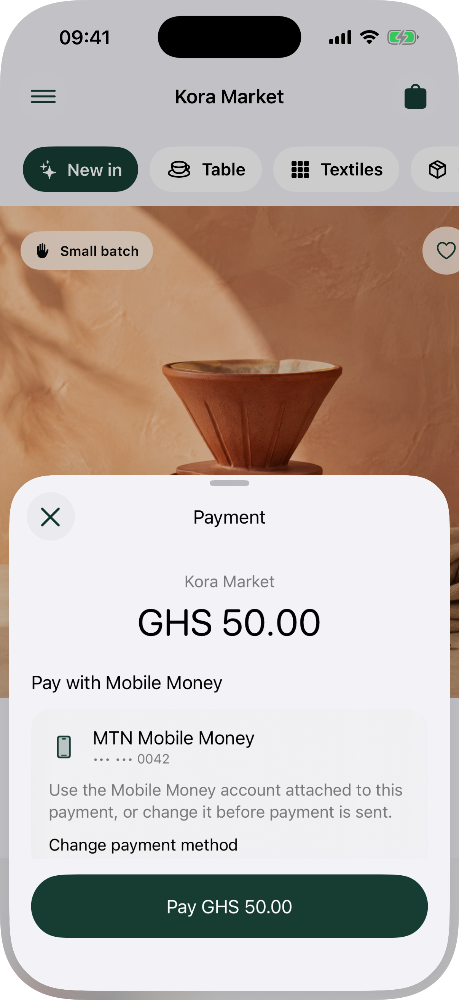
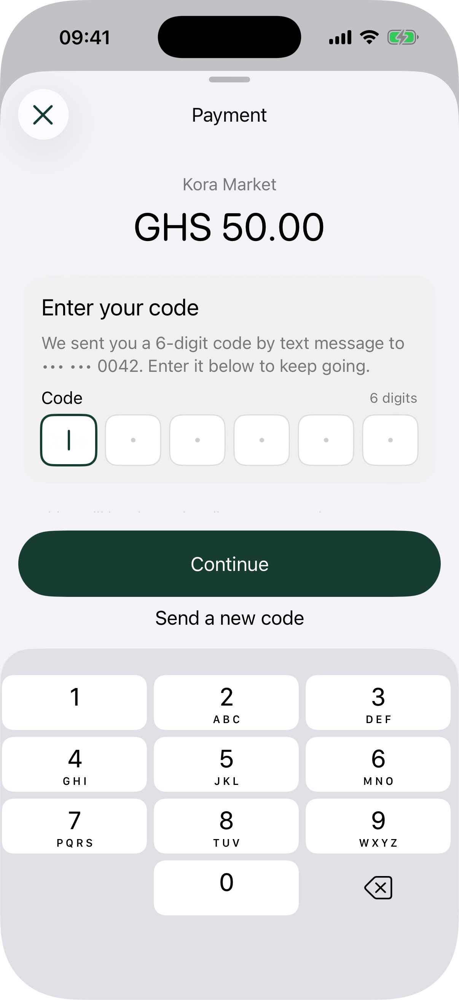
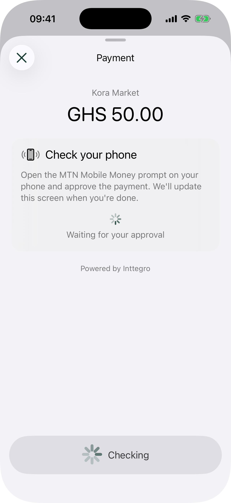
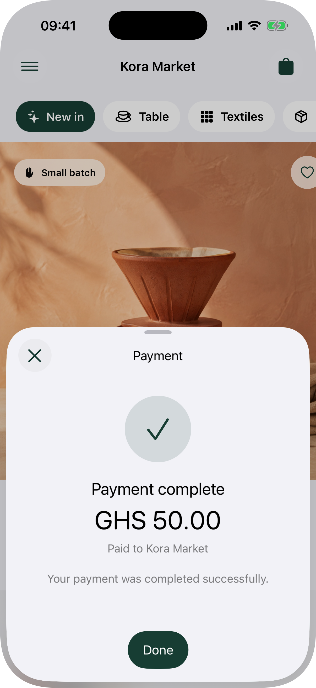

# Inttegro SDK for iOS

[API reference](https://mobile.inttegro.dev/v0.4.3/ios/documentation/inttegro/) ·
[Studio guide](https://studio.inttegro.com/mobile/ios)

Present native Inttegro Checkout without sending secret API keys through your
iOS application.

## Install

In Xcode, choose **File → Add Package Dependencies** and enter:

```text
https://github.com/inttegro/inttegro-sdk-ios.git
```

Or add Inttegro to your package manifest:

```swift
dependencies: [
    .package(
        url: "https://github.com/inttegro/inttegro-sdk-ios.git",
        from: "0.4.3"
    ),
]
```

Then import the module:

```swift
import Inttegro
```

SwiftUI applications can present `InttegroPaymentSheet` directly or use the
`inttegroPaymentSheet` view modifier. UIKit applications can use
`PaymentSheet.present(from:completion:)`.

The Swift package exposes two focused products:

- `Inttegro` contains the native payment sheet, Checkout contract, and
  host-owned telemetry APIs used by Swift applications.
- `InttegroBridge` contains the Objective-C-compatible coordinator used by
  framework adapters. Native applications do not need to link it.

CocoaPods retains the compatibility-friendly `Inttegro` module while compiling
both source areas for the official React Native and Flutter integrations. Those
wrappers share `PaymentSheetCoordinator` instead of reimplementing Checkout or
presentation behavior.

## Native payment flow

<table>
  <tr>
    <td></td>
    <td></td>
  </tr>
  <tr>
    <td></td>
    <td></td>
  </tr>
</table>

These are genuine iPhone Simulator captures of this SwiftUI payment sheet. A
deterministic demo adapter supplies non-sensitive checkout data and never sends
a payment.

Pass either the public Checkout Order ID created by your backend or a public
Purchase Intent from a Buy link. Never embed `INTTEGRO_API_KEY` in an iOS
application. The default adapter retrieves the
checkout from `https://api.inttegro.com/checkout/lookup` and submits a supported
attached payment method or newly entered mobile-money details to `/checkout/pay`
with an idempotency key. Optional billing details describe the payer; the SDK
does not send or change shipping details. Card and Apple Pay are not supported
in this version and are not exposed in configuration or UI.

Use `PaymentSheetConfiguration.Features` to opt into line-item presentation or
invoice and receipt downloads on the completed sheet. Those three capabilities
default to off. `allowPaymentMethodChange` defaults to `true`; set it to `false`
when an attached payment method must not be replaced. Orders without an
attached method still collect one.

For a Buy link, initialize with
`PaymentSheetConfiguration(purchaseIntentID:title:returnURL:appearance:telemetry:features:)`.
Both Order and Purchase Intent configurations accept a visible `title` and an
appearance theme of `.light`, `.dark`, or `.system`; `.system` is the default.
The native sheet retrieves the authoritative product choices and lets the
payer choose the variant, quantity, customer identity, and—when supported—
amount. It calls `/checkout/pay` with the complete purchase and payment
selection only when the payer presses Pay. Checkout creates the finalized Order
and starts that payment attempt together under one stable idempotency key.

The native sheet supports payer-supplied mobile-money and billing-detail forms,
plus confirmation-code request and submission. HTTPS provider redirects open
in `SFSafariViewController`; provider or device approval keeps the sheet in a
waiting state while it refreshes the public Checkout projection. A response
that needs an unsupported action or is still processing is never reported as a
completed payment.

## Checkout lifecycle

Pass `eventHandler` for application behavior and use the completion callback
for the one terminal event. The lifecycle matches Inttegro's web, Android,
React Native, and Flutter SDKs; a completed result contains the full client-safe
Order snapshot rather than a Payment ID.

```swift
let sheet = PaymentSheet(
    configuration: configuration,
    telemetryEventHandler: nil,
    eventHandler: handleCheckoutEvent
)
sheet.present(from: viewController) { result in
    if case let .completed(event) = result {
        verifyOrderFromBackend(event.order!.id)
    }
}
```

Each event includes `occurredAt`, `flowID`, and a monotonic `sequence` for the
presentation. Order-backed events include a client-safe `order`; action and
failure events add sanitized `action` or `failure` values. Lifecycle delivery
does not depend on telemetry being enabled.

## Telemetry

UIKit hosts can receive diagnostic and network events separately from the
Checkout lifecycle:

```swift
let configuration = try PaymentSheetConfiguration(
    orderID: orderID,
    telemetry: .init(
        traceParent: currentTraceParent,
        traceState: currentTraceState
    )
)
let sheet = PaymentSheet(
    configuration: configuration,
    telemetryEventHandler: { event in
        recordInttegroEvent(event)
    }
)
```

`InttegroPaymentSheet` and the `inttegroPaymentSheet` modifier accept the same
`telemetryEventHandler`. Inttegro does not install an exporter; the host maps
events into its own OpenTelemetry provider, logs, or diagnostics. Events never
contain Order or Payment IDs, customer or payer data, payment-method details,
bodies, redirect URLs, or raw error messages.

Checkout mutations honor a valid `Retry-After` response once while preserving
the original idempotency key. Diagnostic events can include `requestID` and
`retryAfterSeconds` for support correlation and retry UX.
